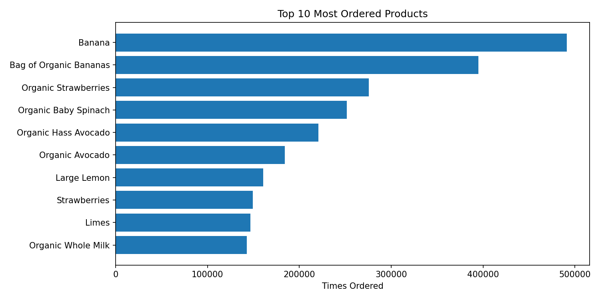
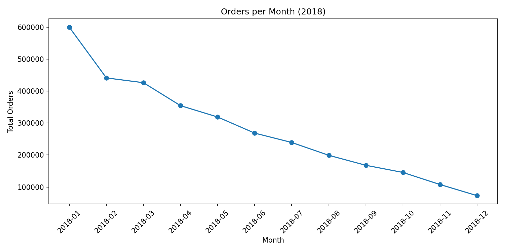
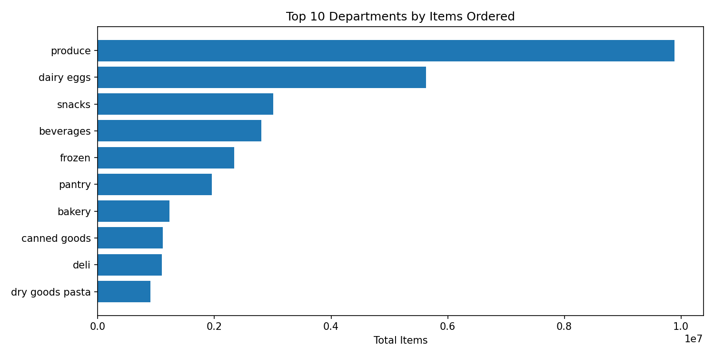

# Instacart Grocery Orders Analysis (SQL + Python)

Analysis of 3.3M grocery orders and 33.8M order items to understand
customer buying behavior, using DuckDB, SQL and pandas on an 8 GB laptop.

## Tools
Python, DuckDB (SQL), pandas, matplotlib, Jupyter Notebook

## Why DuckDB?
The largest file has 33.8M rows (534 MB). Loading it into pandas can
freeze a low-RAM laptop. DuckDB queries the CSV directly from disk and
returns only small results, which pandas then charts.

## Dataset
- products: product_id, product_name, aisle_id, department_id
- orders: order_id, user_id, timestamp
- all_order_products: order_id, product_id, add_to_cart_order

(Department names come from the public Instacart dataset documentation.)

## Key Findings
1. **Scale:** 3.35M orders from 206K customers (Jan 2018 - Jan 2019),
   about 16 orders per customer.
2. **Timing:** Orders are highest from late morning (10:00-11:00) to
   mid-afternoon (15:00), ramp up from 07:00 and are lowest at
   03:00-04:00. Monday and Tuesday are busiest, Sunday is lowest.
3. **Top products:** Bananas lead (regular + organic = ~886K orders).
   9 of the top 10 products are fresh produce, 6 of 10 are organic.
4. **Departments:** Produce is 29% of all items and dairy & eggs 17%.
   The top 5 departments make up about 70%.
5. **Basket size:** Customers order about 10 items on average
   (largest basket: 145 items).
6. **Repeat buying:** About 40% of products a customer buys are
   bought again.

## Data Notes
- Monthly orders fall from 600K to 73K during 2018. This is likely a
  data artifact, not a real sales drop.
- Every customer has at least 3 orders, so the data only contains repeat
  customers. Retention cannot be measured from it, and the 40% repeat
  rate may be higher than in a business with many one-time customers.
- The repeat rate is measured within a roughly one-year window, so it
  is an approximation of true repeat behavior.

## Charts

## Business Recommendations
- Keep produce always fresh and in stock.
- Schedule delivery staff and pickers for weekday mornings (10:00-11:00)
  and afternoons (around 15:00).
- Use "buy again" reminders for frequently repeated products.
- Offer free delivery above a basket-size threshold.

## How to Run
1. Download the dataset from Kaggle and put the 3 CSV files in a `data/` folder:
   https://www.kaggle.com/datasets/brendanartley/simplifiedinstacartdata
2. `pip install duckdb pandas matplotlib jupyter`
3. Open `instacart-analysis.ipynb`.